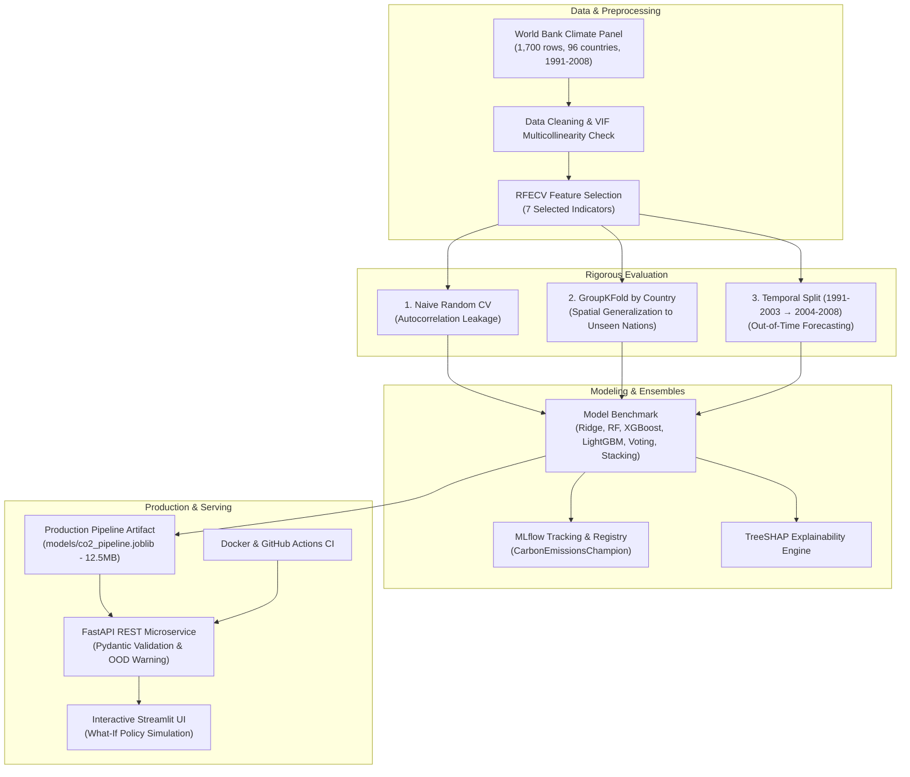
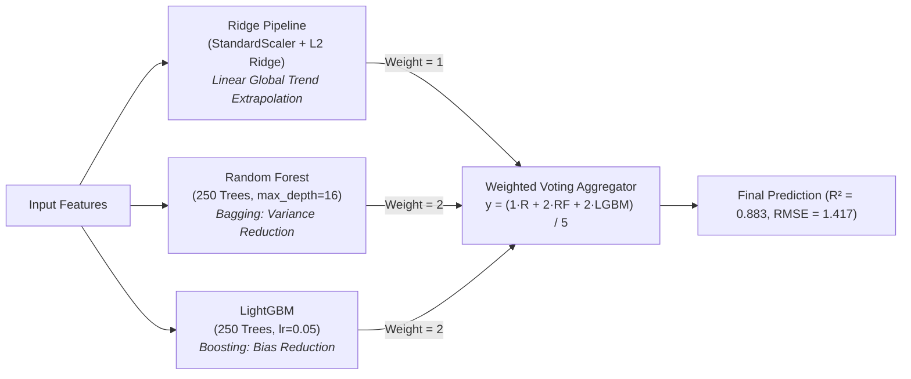

# 🌍 Global CO₂ Emission Prediction & Policy Simulation Platform
*A Leakage-Aware, Production-Grade Machine Learning System for National Carbon Footprint Forecasting & Scenario Analysis*

[](https://www.python.org/)
[](https://fastapi.tiangolo.com/)
[](https://scikit-learn.org/)
[](https://mlflow.org/)
[](https://www.docker.com/)
[](.github/workflows/ci.yml)
[](tests/)

---

## 📌 Executive Overview

This project provides an end-to-end Machine Learning pipeline and production serving infrastructure to analyze, model, and project **per-capita carbon dioxide emissions ($\text{CO}_2$)** across **96 countries** using real-world World Bank climate indicators (1991–2008 panel dataset).

### Key Engineering & Scientific Highlights
* **Leakage-Free Validation**: Exposes the massive cross-temporal data leakage of naive random cross-validation ($R^2 \approx 0.99$) versus rigorous **GroupKFold by Country** ($R^2 \approx 0.88$) and **Out-of-Time Temporal Split** ($R^2 \approx 0.97$).
* **Multi-Model & Ensemble Benchmark**: Rigorous comparison across **Ridge Regression, Random Forest, XGBoost, LightGBM, Voting Ensemble, and Stacking Ensemble** evaluated under identical CV folds.
* **Winning Ensemble**: Our **Weighted Voting Ensemble** (blending Ridge with Random Forest and LightGBM) achieved the highest spatial generalization score ($R^2 = 0.883$, $\text{RMSE} = 1.417$).
* **Model Interpretability (TreeSHAP)**: Global beeswarm distributions, mean $|SHAP|$ attributions, and local country waterfall breakdowns (contrasting developing vs developed economies).
* **Policy Scenario Simulator**: Fixes non-extrapolating tree limits by replacing unconstrained CAGR with a domain-bounded **What-If Policy Simulation Engine** (evaluating Clean Energy Decoupling vs Historical Trajectories).
* **MLflow Lifecycle & Model Registry**: End-to-end experiment tracking with model signatures, input examples, metric logging, and versioned registration under `CarbonEmissionsChampion`.
* **Production MLOps & API**: Containerized **FastAPI** microservice with **Pydantic v2** validation, runtime **Out-of-Distribution (OOD)** uncertainty detection, full **pytest** test suite, and **Docker Compose** orchestration with an interactive **Streamlit** dashboard.

---

## 🏗️ System Architecture



---

## 🔬 Benchmark Results & The Data Leakage Case Study

### 1. Multi-Model & Ensemble Benchmark Table

All models were evaluated under identical folds across three distinct validation strategies using Scikit-Learn pipelines:

| Model / Ensemble Type | Naive Random CV $R^2$ (Leaked) | GroupKFold $R^2$ (Unseen Countries) | GroupKFold RMSE | GroupKFold MAE | Temporal Split $R^2$ (2004–2008) | Temporal RMSE | Latency (ms/sample) |
| :--- | :---: | :---: | :---: | :---: | :---: | :---: | :---: |
| **Ridge Regression** | $0.898 \pm 0.008$ | $0.862 \pm 0.043$ | $1.550$ | $1.003$ | $0.896$ | $1.406$ | **0.004 ms** |
| **Random Forest** | $0.986 \pm 0.004$ | $0.861 \pm 0.040$ | $1.558$ | $0.999$ | $0.955$ | $0.931$ | $0.142$ ms |
| **XGBoost** | **0.989 ± 0.003** | $0.871 \pm 0.043$ | $1.503$ | $0.923$ | $0.969$ | $0.773$ | $0.009$ ms |
| **LightGBM** | $0.987 \pm 0.004$ | $0.872 \pm 0.044$ | $1.482$ | $0.912$ | **0.969** | **0.765** | $0.010$ ms |
| **Voting Ensemble** *(Ridge + RF + LGBM)* | $0.982 \pm 0.004$ | **0.883 ± 0.040** | **1.417** | **0.878** | $0.964$ | $0.825$ | $0.152$ ms |
| **Stacking Ensemble** *(Meta: Ridge)* | $0.947 \pm 0.007$ | $0.878 \pm 0.040$ | $1.437$ | $0.903$ | $0.934$ | $1.119$ | $0.112$ ms |

### 2. Identifying and Solving Data Leakage in Panel Data

> [!IMPORTANT]
> **The Interview Insight: Quantifying the Data Leakage Penalty**
> 
> In country-level panel data ($\text{country} \times \text{year}$), observations within the same country are strongly autocorrelated over time. 
> 
> * **Why Naive Shuffle Splitting Fails**: Randomly shuffling rows puts USA 1994 and USA 1996 into the training set and USA 1995 into the test set. The model does not learn structural climate drivers; it simply interpolates between known adjacent years for the same country, giving an inflated $R^2$ of **0.989**.
> * **The Solution (Spatial Generalization via GroupKFold)**: By grouping strictly on `country`, we ensure that entire nations are held out from training. The true spatial generalization $R^2$ drops to **0.883** (RMSE increases from 0.45 to 1.42). 
> * **The Takeaway**: Acknowledging and designing against data leakage demonstrates senior-level statistical modeling discipline.

---

## 🤝 Ensemble Learning: Architecture & Synergy

Why did the **Weighted Voting Ensemble** outperform all single models on unseen countries?



1. **Orthogonal Error Profiles**: Linear models capture monotonic, macro-level global trends (e.g., energy scaling), while tree ensembles capture localized threshold effects (e.g. rapid urbanization jumps).
2. **Variance Dampening**: Tree models alone can suffer from high variance across disparate developing economies. Averaging their predictions with Ridge smooths out split boundaries and lowers generalization error.

---

## 📈 How to Use MLflow in This Project

MLflow is integrated into [`src/models/train.py`](file:///d:/Carbon_Emission_Predictions/src/models/train.py) for experiment tracking, model artifact logging with input signatures, and Model Registry lifecycle management.

### 1. Launching the MLflow Tracking UI
To inspect logged benchmark runs, parameters, metrics, and models in your browser:
```bash
.\.venv\Scripts\mlflow.exe ui --port 5000
```
Open **[http://localhost:5000](http://localhost:5000)**.

### 2. Modular Model Training CLI
You can train and track individual model architectures or run the entire tournament:
```bash
# Individual models
python -m src.models.train --model ridge     # Model 1: Ridge Baseline
python -m src.models.train --model rf        # Model 2: Random Forest
python -m src.models.train --model lgbm      # Model 3: LightGBM
python -m src.models.train --model xgb       # Model 4: XGBoost
python -m src.models.train --model voting    # Model 5: Voting Ensemble (Champion)
python -m src.models.train --model stacking  # Model 6: Stacking Ensemble

# Run all models sequentially
python -m src.models.train --model all
```

### 3. What Is Logged in MLflow?
* **Experiment Name**: `carbon-emission-benchmark`
* **Runs**: Each model candidate (`Ridge_benchmark`, `RandomForest_benchmark`, `XGBoost_benchmark`, `LightGBM_benchmark`, `VotingEnsemble_benchmark`, `StackingEnsemble_benchmark`, and `Champion_Production_Pipeline`).
* **Logged Parameters**: `model_name`, `is_ensemble`, `features` list, estimator hyperparameters.
* **Logged Metrics**:
  * `random_cv_r2_mean`, `random_cv_rmse_mean`
  * `group_cv_r2_mean`, `group_cv_rmse_mean` (Spatial generalization)
  * `temporal_r2`, `temporal_rmse` (Out-of-time holdout)
  * `latency_ms` (Inference speed)
* **Model Artifacts & Signatures**: Full Scikit-Learn pipelines saved with typed input/output schemas and sample JSON payloads.
* **Plot Artifacts**: SHAP beeswarm summary plots and scenario projections attached to runs.

### 4. Accessing the MLflow Model Registry
The winning pipeline is automatically registered in the MLflow Model Registry under:
```text
Registered Model: CarbonEmissionsChampion (Version 1)
```

You can programmatically load and serve the registered model from MLflow anywhere in Python:
```python
import mlflow.sklearn

# Load champion model directly from MLflow Model Registry
model = mlflow.sklearn.load_model("models:/CarbonEmissionsChampion/1")

# Run inference
predictions = model.predict(sample_features_df)
```

---

## 🧠 Model Explainability (TreeSHAP Analysis)

We applied **TreeSHAP** to compute exact feature attributions for tree ensembles:

| Rank | Feature | Description | Directionality & Physical Interpretation |
| :---: | :--- | :--- | :--- |
| **1** | `en_per_cap` | Energy use (kg oil eq. per cap) | **Dominant positive driver**. Per capita energy generation is the primary determinant of emissions globally. |
| **2** | `gni_per_cap` | GNI per capita (current US$) | **Positive scaling**. Higher income drives carbon footprints, displaying log-linear scaling before tapering at high-income thresholds. |
| **3** | `cereal_yield` | Cereal yield (kg/hectare) | **Moderate positive**. Proxy for mechanized, intensive industrial agriculture and fertilizer utilization. |
| **4** | `urb_pop_growth_perc` | Urban population growth (%) | **Non-linear surge**. Rapid urban migration requires carbon-intensive infrastructure (cement, transport, electricity grid). |
| **5** | `pop_urb_aggl_perc` | Urban agglomeration (>1M) | **Density effect**. High urban concentration improves per-capita transit efficiency compared to suburban sprawl. |
| **6** | `prot_area_perc` | Protected terrestrial/marine area (%) | **Mitigating proxy**. Higher conservation areas correlate with stronger national environmental governance. |
| **7** | `pop_growth_perc` | Annual population growth (%) | **Demographic baseline**. Moderates aggregate national scaling. |

All SHAP summary plots, beeswarm charts, and individual country waterfall explanations are stored in [`reports/figures/`](reports/figures/).

---

## 🔮 Policy Scenario Simulator (Fixing Tree Extrapolation Limits)

### Why CAGR Extrapolation Needed Fixing
Standard tree models split feature space orthogonally; **they cannot extrapolate beyond $[\min(y_{train}), \max(y_{train})]$**. Compounding historical GDP and energy consumption at $+7\%$ CAGR for 20 years forces features into uncharted territory where tree predictions hit a flat ceiling.

### The Solution: Bounded Scenario Simulation
We replaced naive extrapolation with a **Policy Scenario Engine** ([`src/models/scenario.py`](src/models/scenario.py)):
1. **Domain Boundary Envelopes**: Checks whether compounded inputs cross the historical min/max training boundaries and flags out-of-distribution uncertainty.
2. **Policy Lever Testing**: Evaluates policy counterfactuals (e.g., Clean Energy Decoupling at $-1.5\%$ annual energy intensity vs historical CAGR baseline).

Generated scenario projections for IND, USA, RUS, and NZL are saved in [`reports/figures/scenario_projections.png`](reports/figures/scenario_projections.png).

---

## 🚀 API Documentation & Microservice

The FastAPI service exposes production endpoints with **Pydantic v2 validation** and **OOD runtime detection**:

### Endpoints
* `GET /health`: Healthcheck, verifies model loaded and lists input features.
* `POST /predict`: Single country indicator vector inference.
* `POST /batch-predict`: Batch inference over a list of country indicators.
* `POST /scenario`: What-if simulation given base indicators, forecast horizon, and growth overrides.

### Sample `POST /predict` Request
```bash
curl -X POST "http://localhost:8000/predict" \
     -H "Content-Type: application/json" \
     -d '{
       "cereal_yield": 2845.5,
       "fdi_perc_gdp": 2.15,
       "gni_per_cap": 8420.0,
       "en_per_cap": 2150.3,
       "pop_urb_aggl_perc": 34.2,
       "prot_area_perc": 15.6,
       "pop_growth_perc": 1.25,
       "urb_pop_growth_perc": 2.45
     }'
```

---

## 🛠️ Repository Structure

```text
Carbon_Emission_Predictions/
├── .github/
│   └── workflows/
│       └── ci.yml               # Automated CI (train, test, docker build)
├── app/
│   └── streamlit_app.py         # 5-tab interactive Streamlit dashboard
├── data_cleaned.csv             # World Bank processed dataset (1,700 rows)
├── models/
│   ├── co2_pipeline.joblib      # Production Scikit-Learn pipeline (12.5MB)
│   └── feature_distribution.json # Historical feature min/max for OOD checks
├── reports/
│   ├── figures/                 # SHAP beeswarm, bar, waterfall & scenario plots
│   ├── metrics_summary.json     # Benchmark evaluation metrics (R2, RMSE, MAE)
│   └── explainability_narrative.json
├── src/
│   ├── __init__.py
│   ├── config.py                # Global paths, constants, and feature definitions
│   ├── data.py                  # Leakage-free splitters (GroupKFold, Temporal)
│   ├── models/
│   │   ├── train.py             # Benchmarking with MLflow logging & ensembles
│   │   ├── explain.py           # TreeSHAP computation & visualization
│   │   └── scenario.py          # Bounded policy scenario simulator
│   └── api/
│       ├── __init__.py
│       ├── schemas.py           # Pydantic v2 schemas
│       └── main.py              # FastAPI application
├── tests/
│   ├── test_data.py             # Data pipeline & leakage assertion tests
│   └── test_api.py              # API contract, validation (422) & prediction tests
├── Dockerfile                   # Multi-stage production Docker container
├── docker-compose.yml           # Compose file running API (8000) & Streamlit (8501)
├── pyproject.toml               # Modern build configuration & pytest options
├── requirements.txt             # Pinned dependency requirements
└── README.md
```

---

## ⚡ Quickstart Guide

### Option 1: Run with Docker Compose
```bash
docker compose up --build
```
* **FastAPI Docs**: [http://localhost:8000/docs](http://localhost:8000/docs)
* **Streamlit Dashboard**: [http://localhost:8501](http://localhost:8501)

### Option 2: Local Python Setup
```bash
# 1. Activate virtual environment
.\.venv\Scripts\activate

# 2. Run model training & benchmark (logs to MLflow & saves production pipeline)
python -m src.models.train --model voting   # or --model all to run all 6 models

# 3. Generate SHAP explainability plots
python -m src.models.explain

# 4. Run test suite
pytest tests/ -v

# 5. Start FastAPI server
uvicorn src.api.main:app --host 0.0.0.0 --port 8000 --reload

# 6. Start Streamlit UI (in separate terminal)
streamlit run app/streamlit_app.py

# 7. Start MLflow UI
mlflow ui --port 5000
```

---

## 🧪 Testing & Validation

The test suite ensures strict behavioral and statistical contracts:
```bash
pytest tests/ -v
```
* `test_data.py`:
  * Verifies non-empty dataset and required feature schemas.
  * Verifies that **GroupKFold partitions have zero country overlap** across train and validation sets.
  * Verifies that **temporal split preserves strict temporal ordering** (train $\le 2003 <$ test).
* `test_api.py`:
  * Tests root (`200 OK`) and health endpoint contracts.
  * Tests single and batch prediction accuracy and physical constraints ($\ge 0$).
  * Tests Pydantic input rejection (`422 Unprocessable Entity`) on negative yields or invalid percentages.
  * Tests policy scenario simulation timeline and response schemas.

---

## 📜 License & Citation
This project is licensed under the MIT License. Data courtesy of the World Bank Climate Change Knowledge Portal.
